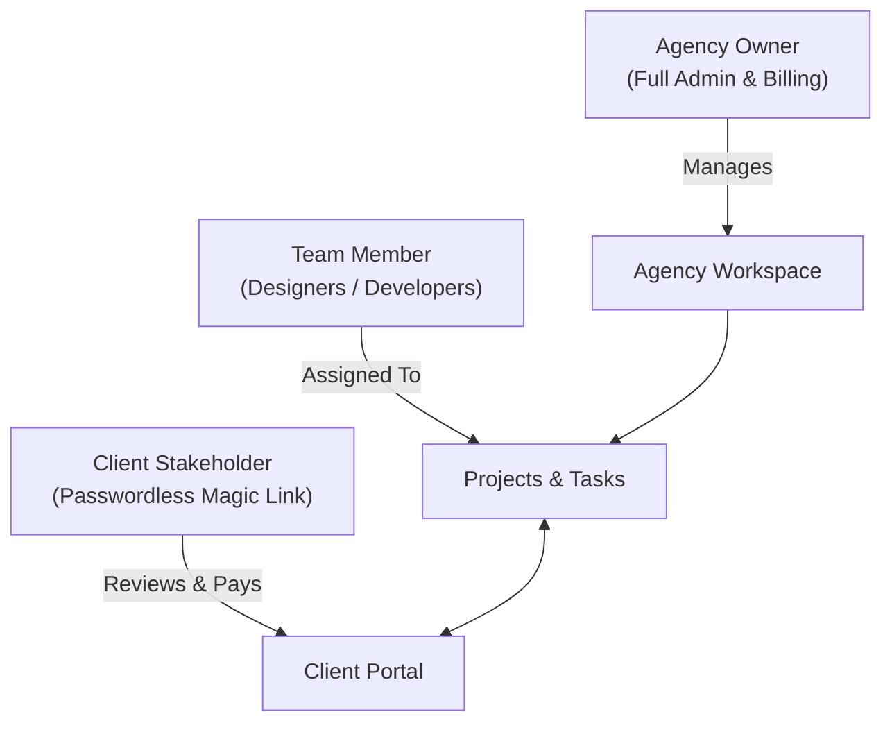
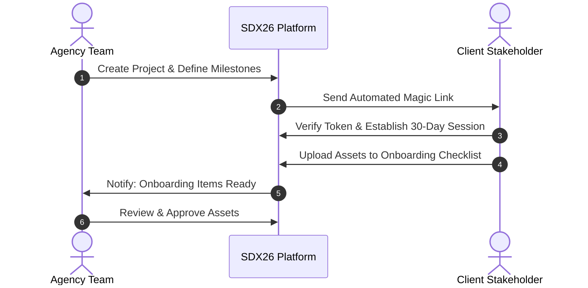
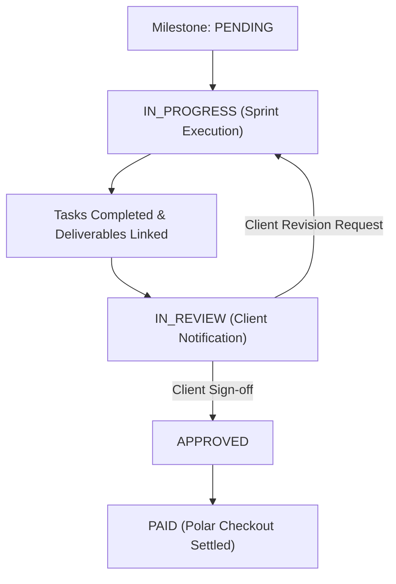

# SDX26 — Client Collaboration & Project Hub for Modern Agencies

<div align="center">

[](./LICENSE)
[](https://nextjs.org/)
[](https://react.dev/)
[](https://www.typescriptlang.org/)
[](https://tailwindcss.com/)
[](https://www.prisma.io/)
[](https://polar.sh/)
[](https://www.postgresql.org/)

<p align="center">
  <strong>A premium, white-label client collaboration portal and project management platform purpose-built for digital, creative, and software agencies.</strong>
</p>

<p align="center">
  <a href="https://youtu.be/yL1gsl_b4oI"><strong>Watch Video Walkthrough ↗</strong></a> •
  <a href="./LICENSE"><strong>License Terms</strong></a> •
  <a href="#-core-system-modules"><strong>System Modules</strong></a> •
  <a href="#-author--contact"><strong>Author & Contact</strong></a>
</p>

</div>

---

> [!IMPORTANT]
> **PORTFOLIO & TECHNICAL EVALUATION NOTICE:**  
> This public repository contains original work and proprietary software architecture by **Sayan Das**. It is published strictly for technical evaluation, code review, and hiring/recruitment consideration. Commercial use, reproduction, cloning, or public deployment is strictly prohibited under the [Proprietary & All Rights Reserved License](./LICENSE).

---

## 🎯 The Core Problem & The Solution

### The Agency Chaos
When creative, digital, and software engineering agencies work with clients, communication and operational momentum routinely fracture across disconnected tools:
* **Asset Collection Delays**: Requirements, vector logos, brand palettes, and credentials get buried across multi-week email threads.
* **Client Login Friction**: Clients abandon complex task-management platforms (Asana, ClickUp) due to password fatigue and revert to emailing attachments.
* **Version Control Nightmares**: Deliverables get confused in a flurry of `"final_v2_FINAL_actual.png"` links scattered across Drive and WeTransfer.
* **Uncontrolled Scope Creep**: Informal *"can you tweak this one small thing?"* requests eat into agency margins without formal approval or budget adjustments.
* **Payment Uncertainty**: Releasing work before payment or waiting 30–60 days for invoices to clear causes severe cashflow lag.

### The SDX26 Solution
SDX26 standardizes the client collaboration lifecycle into a single, high-authority workspace:
* **Executive Command Center**: A centralized agency view of active projects, sprint task breakdowns, pending sign-offs, and financial health.
* **Frictionless Client Portal**: Clients access a dedicated, branded workspace via time-sensitive, passwordless **Magic Links**—no registration hurdles.
* **In-Place Semantic Versioning**: Deliverables and staging links iterate in-place (`v1`, `v2`, `v3`) with change logs and zero duplicate clutter.
* **Scope Creep Protection**: Bi-directional Change Request log that quantifies cost and timeline impacts and auto-converts approved requests into payable milestones.
* **Milestone-Linked Payments**: Direct integration with **Polar.sh** ensures invoices and ad-hoc checkouts settle before deliverables are released.

---

## 👥 User Roles & Permission Hierarchy

SDX26 enforces a hybrid Role-Based Access Control (RBAC) architecture separating administrative ownership from execution and client access:



### 1. Agency Owner
* Complete control over agency workspace, branding, logo, and custom slug (`agency-slug.milestack.com`).
* Manages team invitations with plan seat limit enforcement (`Basic`, `Starter`, `Pro`, `Enterprise`).
* Oversees financial metrics, milestone payment status, and Polar subscription billing.
* Master administrative access across all projects, deliverables, and audit logs.

### 2. Team Member
* Accesses assigned client projects with specific designations (`DEVELOPER`, `DESIGNER`, `PROJECT_MANAGER`, etc.).
* Creates, updates, prioritizes (`LOW`, `MEDIUM`, `HIGH`), and completes milestone tasks.
* Uploads binary deliverables and live external links (Vercel previews, Figma, Loom).
* Participates in milestone discussion threads and evaluates client onboarding uploads.

### 3. Client Stakeholder
* Instant access via secure 32-byte cryptographic Magic Links—zero password fatigue.
* Submits required onboarding assets (logos, hosting logins, copy) with live verification states.
* Inspects versioned deliverables and tests live staging environments.
* Formally approves milestones, initiates out-of-scope change requests, and pays invoices via Polar checkout.

---

## 🏛️ High-Level System Architecture

```mermaid
graph LR
    subgraph Agency_Hub [Agency Hub]
        Dashboard["Overview Dashboard"]
        ProjectWorkspace["Projects & Milestones"]
        TeamHub["Team Roster & Roles"]
        SettingsHub["Branding & Custom Slug"]
    end

    subgraph Collaboration_Engine [Collaboration Engine]
        Milestones["Milestone Engine"]
        Tasks["Actionable Tasks"]
        Files["Asset Version Control"]
        Scope["Change Request System"]
        Activity["Real-time Audit Log"]
    end

    subgraph Client_Experience [Client Experience]
        MagicLink["Cryptographic Magic Link"]
        PortalView["White-label Client Portal"]
        OnboardingChecklist["Asset Intake"]
        Payments["Polar.sh Checkout"]
    end

    Agency_Hub --> Collaboration_Engine
    Collaboration_Engine <--> Client_Experience
```



---

## 🔄 End-to-End Operational Workflows

### 1. Agency Setup & Team Onboarding
1. **Workspace Claim**: The agency founder registers via NextAuth (Credentials or OAuth) and claims a unique agency slug.
2. **White-Label Branding**: Agency profile, display name, and logo are configured in `/dashboard/settings`.
3. **Seat-Governed Invitations**: The owner sends team invites from `/dashboard/team/invite`. The system enforces seat limits against the active plan, generates a 7-day cryptographic token, and provides a dual acceptance path for existing and new users at `/invite/[token]`.

---

### 2. Project Kickoff & Client Onboarding
1. **Project Creation**: Agency registers a client profile and launches a project with deadlines and milestones.
2. **Automated Magic Link**: A secure, single-use token is generated (`expiresAt: 7 days`) and automatically dispatched to the client's email.
3. **Checklist Fulfillment**: The client opens their portal (`/portal/[token]/onboarding`) and uploads required assets.
4. **Agency Verification**: Agency reviewers mark items as [STATUS:APPROVED] or [STATUS:REJECTED], advancing the kickoff progress bar.



---

### 3. Milestone Execution, Tasks & Contextual Discussions
Projects progress through sequential milestones (e.g., *Phase 1: Discovery*, *Phase 2: UI Design*, *Phase 3: Production Build*):



* **Actionable Tasks**: Internal sprint tasks with priorities (`LOW`, `MEDIUM`, `HIGH`) and assignee avatars remain private to agency staff.
* **Discussion & Feedback**: Pinned message streams on each milestone allow clients and developers to communicate in context (`Ctrl + Enter` to send), eliminating WhatsApp or email sprawl.

---

### 4. Semantic File Versioning & Deliverable Previews
* **Dual Deliverable Types**: Supports both binary assets (PDFs, ZIPs, SVGs) and external staging links (Vercel, Figma, Loom, GitHub PRs).
* **Zero Storage Cost for Links**: External staging and prototype links consume 0 MB of agency storage quota.
* **In-Place Versioning**: Click `+ New Version` to increment (`v1` ➔ `v2` ➔ `v3`) with mandatory change notes, preserving a complete audit trail without file clutter.

---

### 5. Scope Creep Protection & Change Requests
When clients request additional features outside the agreed project scope:
1. **Request Submission**: Client submits an idea in `/portal/[token]/scope` ([STATUS:SUBMITTED]).
2. **Agency Review**: Agency assesses the item in `/dashboard/projects/[id]/scope`, assigns pricing (e.g., `$850`), and sets timeline impact (e.g., `+3 days`).
3. **Client Sign-off**: Client reviews the proposal ([STATUS:PENDING_CLIENT_APPROVAL]) and clicks **Approve**.
4. **Atomic Milestone Conversion**: SDX26 executes a Prisma transaction that auto-generates a new payable milestone and updates the request to [STATUS:CONVERTED].

---

### 6. Milestone Checkout & Polar.sh Payments
1. **Ad-Hoc Session Generation**: When a milestone is approved, SDX26 invokes the `@polar-sh/sdk` to construct a custom checkout session with milestone metadata.
2. **Frictionless Payment**: Client pays via Credit Card, Apple Pay, or Google Pay.
3. **Webhook Reconciliation**: Polar triggers `/api/webhook/polar`, verifying the signature and updating the milestone to [STATUS:PAID], immediately unlocking final source deliverables.

---

## 📦 Core System Modules

| Module | What It Does | Target Audience |
| :--- | :--- | :--- |
| **Executive Dashboard** | Active projects, pending sign-offs, milestone completion velocity, and pending receivables. | Agency Owners & Staff |
| **Project Workspace** | Central command hub for milestones, internal task ledgers, files, and client communication. | Agency Team Members |
| **Milestone Engine** | Stage-gated progression tracking deliverables, due dates, review states, and payout amounts. | Agency Team & Clients |
| **Task Ledger** | Fine-grained tasks within milestones with priorities (`LOW`, `MEDIUM`, `HIGH`) and assignees. | Agency Team Members |
| **Client Portal** | Dedicated white-label interface for asset intake, deliverable testing, and formal approvals. | Client Stakeholders |
| **Asset Manager** | Deliverables repository supporting binary files and staging links with in-place `v1`..`v3` versioning. | Agency Team & Clients |
| **Scope Log** | Formal Change Request engine calculating cost/timeline impacts and auto-converting into milestones. | Agency Team & Clients |
| **Activity Stream** | Immutable chronological audit trail recording logins, approvals, uploads, and payments. | Agency Owners & Staff |
| **Agency Settings** | Administrative configuration for custom workspace slug, logo, team permissions, and plans. | Agency Owners |

---

## 🛠️ Technical Stack & Implementation Highlights

### Core Framework & Runtime
* **Framework**: [Next.js 16](https://nextjs.org/) (App Router, Server Actions, Dynamic Subdomain Rewrites)
* **UI Library**: [React 19](https://react.dev/) (Server Components, Optimistic Updates)
* **Language**: [TypeScript 5](https://www.typescriptlang.org/) (Strict typing, End-to-End type safety)
* **Styling**: [Tailwind CSS v4](https://tailwindcss.com/) with OKLCH color palettes & [Lucide Icons](https://lucide.dev/)
* **Component Primitives**: [Radix UI](https://www.radix-ui.com/) & [shadcn/ui](https://ui.shadcn.com/)

### Database & Security
* **Database & ORM**: PostgreSQL via [Neon Serverless](https://neon.tech/) & [Prisma ORM 7](https://www.prisma.io/)
* **Dual-Session Architecture**:
  * **Agency Staff**: NextAuth.js (Auth.js v5) with secure session tokens for dashboard routes.
  * **Client Stakeholders**: Stateless, cryptographic [Jose JWT](https://github.com/panva/jose) (`client_session`) valid for 30 days, completely isolated from administrative cookies.
* **Tenant Isolation**: Edge middleware resolving `x-agency-id` from subdomains (`agency-slug.milestack.com`) paired with composite database query filtering.

### Payments & Infrastructure
* **Payment Processing**: [Polar.sh SDK](https://polar.sh/) (Ad-hoc checkouts, webhooks, automated reconciliation)
* **File & Asset Handling**: [UploadThing](https://uploadthing.com/) & S3-compatible cloud storage metering
* **Email Delivery**: [Nodemailer](https://nodemailer.com/) with transactional Magic Link dispatch

---

## ⚖️ License & Intellectual Property Notice

```
Copyright (c) 2024–2026 Sayan Das. All rights reserved.
PROPRIETARY & ALL RIGHTS RESERVED LICENSE (PORTFOLIO & TECHNICAL EVALUATION ONLY)
```

This repository and its underlying source code, database architecture, workflows, and documentation are the proprietary intellectual property of **Sayan Das**.

### Permitted Uses:
* Prospective employers, recruiters, engineering managers, and technical evaluators are granted permission to browse, read, inspect, and evaluate this codebase solely for the purpose of assessing the author's technical competence, system design capabilities, and engineering qualifications for employment or contract roles.
* Non-commercial, private local cloning solely for code review and interview evaluation.

### Strictly Prohibited:
* **No Commercial Use**: You may not copy, clone, distribute, sublicense, modify, or deploy any portion of this codebase to create, operate, or power any commercial SaaS product, agency portal, or competing software service.
* **No Redistribution**: You may not republish, mirror, or redistribute this software, in source or binary form, without express prior written consent from the author.
* **No Unauthorized Deployment**: Hosting or running this software for third-party commercial services is strictly forbidden.

For licensing inquiries or commercial permissions, please contact the author directly.

---

## 👨‍💻 Author & Contact

**Sayan Das**  
*Fullstack Engineer & Software Architect*

* **GitHub**: [@Sayan-01](https://github.com/Sayan-01)
* **Repository**: [https://github.com/Sayan-01/sdx26](https://github.com/Sayan-01/sdx26)
* **Email**: [sayandas61668@gmail.com](mailto:sayandas61668@gmail.com)
* **Demo Walkthrough**: [Watch Product Video](https://youtu.be/yL1gsl_b4oI)
